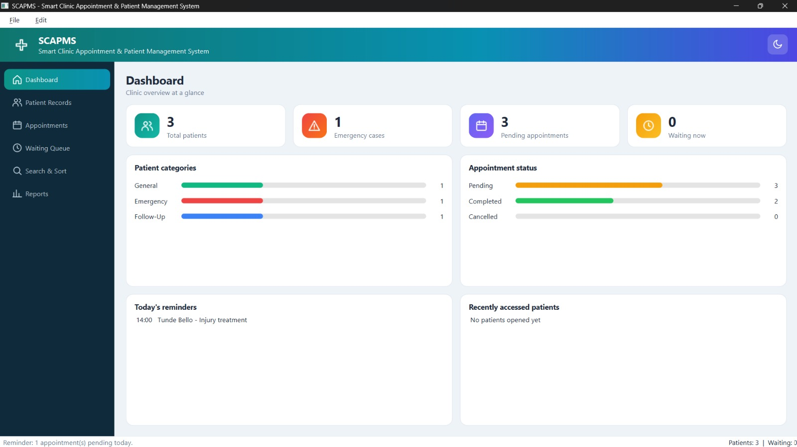
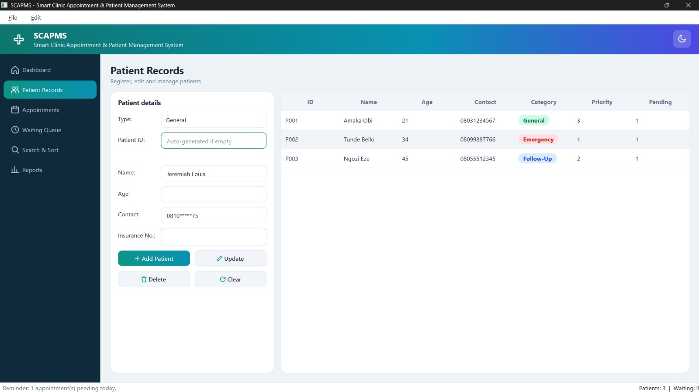
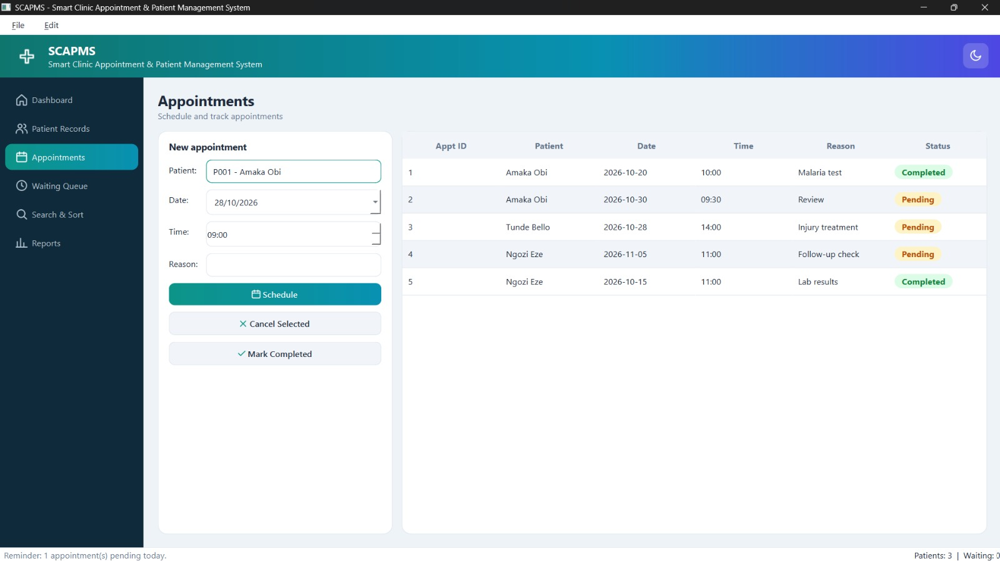
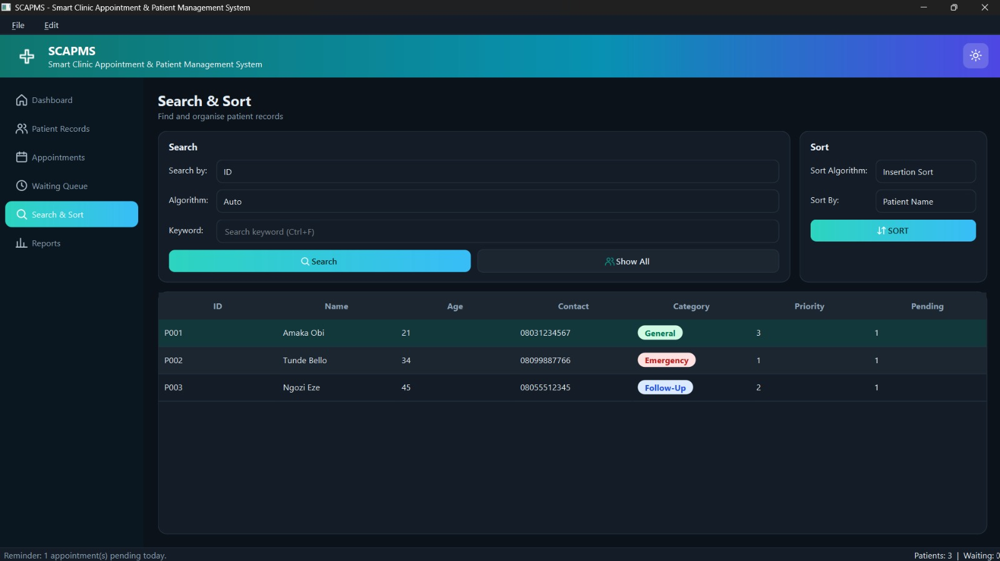
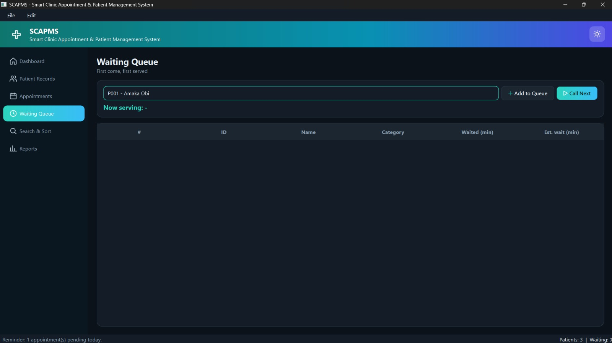
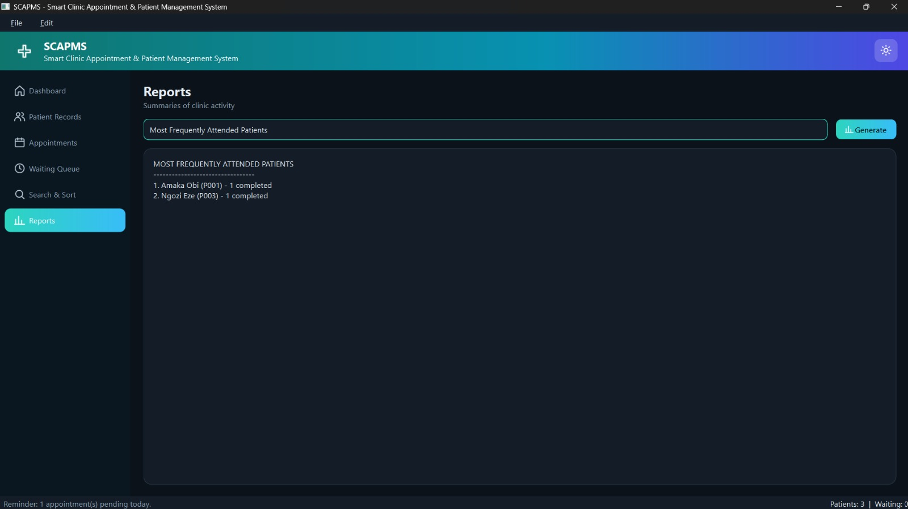
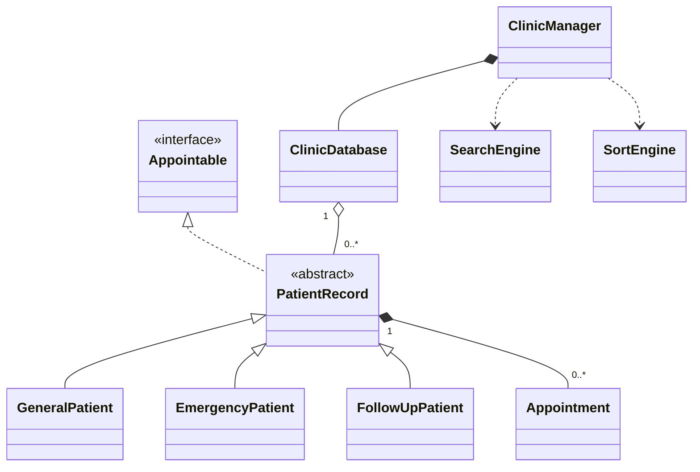

# SCAPMS – Smart Clinic Appointment & Patient Management System

A desktop application for managing a university clinic: patients, appointments, a waiting queue, search and sort tools, and reports. Built with **C++17** and **Qt 6 (Widgets)**, using **CMake**.

> Built for a university Programming II course with AI assistance. See [AI-assisted development](#ai-assisted-development).

## Screenshots

The interface has a light and a dark theme (toggle in the header). Both are shown below.

| Dashboard | Patient Records |
|---|---|
|  |  |

| Appointments | Search & Sort |
|---|---|
|  |  |

| Waiting Queue | Reports |
|---|---|
|  |  |

## Features

- Register, edit and delete patients (General, Emergency and Follow-Up types, each with its own rules)
- Schedule, cancel and complete appointments, with validation (clinic hours, past dates, duplicate slots)
- First-in, first-out waiting queue with a "Call Next" action
- Search by ID, name or category using linear, binary or recursive search (Auto mode picks binary search when the list is sorted)
- Sort by name, ID, age or appointment date using insertion sort or merge sort
- Undo for deleting a patient, editing a patient and cancelling an appointment
- Four reports: most frequently attended patients, pending appointments, category distribution, daily summary
- Save and load to a text file, plus import and export through file dialogs
- Modern interface: icon sidebar, dashboard tiles and charts, status pills, light and dark themes, keyboard shortcuts, tooltips

## Design

| Concept | Where |
|---|---|
| Abstract class and interface | `PatientRecord` (pure virtual functions), `Appointable` |
| Inheritance and polymorphism | `GeneralPatient`, `EmergencyPatient`, `FollowUpPatient`, handled through base-class pointers |
| Composition | `PatientRecord` holds its `Appointment`s; `ClinicManager` owns `ClinicDatabase` |
| Data structures | `std::vector` (patients), `std::queue` (waiting list), `std::stack` (undo), fixed array (recent-patient cache of 10) |
| Algorithms (hand-written) | Linear, binary and recursive search; insertion sort and merge sort |
| Error handling | Custom `ClinicException`, `try/catch` in the GUI, input validation |
| Layers | `model/` (data), `controller/` (logic), `gui/` (Qt interface), `utils/` (helpers) |



## Project structure

```
SCAPMS/
├── CMakeLists.txt
├── main.cpp
├── model/        PatientRecord, Patients, Appointment, Appointable
├── controller/   ClinicDatabase, ClinicManager, SearchEngine, SortEngine
├── gui/          MainWindow, Panels, Widgets, Theme, Icons
├── utils/        Exceptions, IDGenerator
└── data/         scapms_data.txt (sample data)
```

## Build and run

**Requirements:** Qt 6 (Widgets and Svg modules), CMake 3.16 or newer, and a C++17 compiler. It was built and tested with Qt 6.12 and MinGW 64-bit on Windows.

**With Qt Creator (easiest)**
1. Open `CMakeLists.txt` with **File > Open File or Project**.
2. Select a Qt 6 kit and click **Configure Project**.
3. Press **Run**.

**From the command line**
```
cmake -S . -B build -DCMAKE_PREFIX_PATH="<path-to-Qt>/6.x.x/<kit>"
cmake --build build
```

The build copies `data/scapms_data.txt` next to the executable, so the app starts with sample patients and appointments.

## Keyboard shortcuts

| Shortcut | Action |
|---|---|
| Ctrl+S | Save |
| Ctrl+L | Load |
| Ctrl+F | Go to search |
| Ctrl+Z | Undo last administrative operation |
| Ctrl+Q | Exit |

## Sample data

`data/scapms_data.txt` contains fictional patients for demonstration only. Do not store real patient information in this application.

## AI-assisted development

I directed this project with AI assistance (Claude). I defined the requirements from the assessment brief, set up the Qt toolchain, built and ran the application, tested the features, worked through build errors and documented the result. Details are in [AI_ASSISTED.md](AI_ASSISTED.md).

## Roadmap

- Replace the text file with SQLite storage
- Unit tests for the search, sort and validation logic
- Doctor accounts and role-based access
- CSV and PDF report export

## Licence

MIT. See `LICENSE`.

## Author

**Louis Jeremiah** · [GitHub](https://github.com/JeremyDinvestor) · [LinkedIn](https://www.linkedin.com/in/louisjeremy/)
